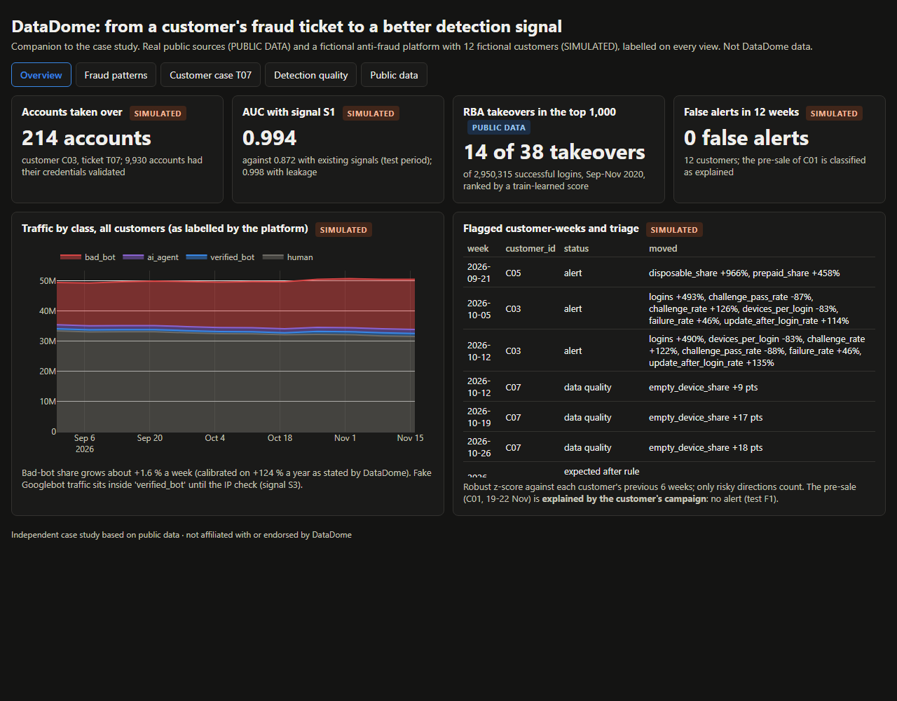

# DataDome: from a customer's fraud ticket to a better detection signal

**[Read the report (PDF)](https://albt-france.github.io/datadome-fraud-patterns-case-study/report/datadome_fraud_analyst_case_study.pdf) · [Open the interactive dashboard](https://albt-france.github.io/datadome-fraud-patterns-case-study/dashboard/)**

<sub>Repository copies: [site/report/datadome_fraud_analyst_case_study.pdf](site/report/datadome_fraud_analyst_case_study.pdf) · [site/dashboard/index.html](site/dashboard/index.html)</sub>

A Fraud Analyst case study: **when a customer writes "our accounts are being stolen" or "our free trials are exploding", how
does an analyst find the fraud pattern, measure what detection missed, send the customer a clear report, and propose a new
signal tested offline, without being fooled by a false alarm or a data problem?**

It uses real public data (31,269,264 synthesized logins from the RBA dataset, 67,352 labelled web sessions, DataDome's published
facts, public crawler lists) and a **simulated** anti-fraud platform with 12 fictional customers and 8 hidden events, labelled
PUBLIC DATA, SIMULATED or ILLUSTRATIVE on every visual. The simulated platform and its customers are fictional and are not
DataDome or DataDome's customers.

## Four key results
1. **Simple takeover rules drown analysts (public data).** On the RBA logins, with rules tuned on Feb-Aug 2020 and tested on
   Sep-Nov 2020, the best rule still raises 531 false alerts per caught takeover. Ranking logins by a score learned on the
   training months puts 14 of 38 takeovers in the top 1,000 of 2.95 M successful logins.
2. **A per-IP limit cannot stop low-and-slow credential stuffing (simulated).** Customer C03 received 400,278 attempts from
   9,400 IPs, never more than 1 per IP and per hour, but from only 25 device hashes. 9,930 accounts had their credentials
   validated and 214 accounts were taken over (e-mail changed within the hour): the case report T07 is generated by a script.
3. **A device-cluster signal measured offline (simulated).** The honest takeover model (signals known at login time, time split)
   goes from AUC 0.872 to 0.994 with the device-cluster signal, and alerts per day fall from 2,256 to 129 at the same recall. A
   model that reads the account table extracted after the facts reaches 0.998 and could never run live (leakage).
4. **Triage before alerting (simulated).** Monitoring 12 customers for 12 weeks finds the 8 events with 0 false alerts: a
   duplicated-event SDK bug that faked a lower deny rate, a rule whose total pass rate went from 52.0% to 68.2% while it fell in
   every channel (Simpson's paradox), a fake Googlebot (1.22 M requests outside Google's published ranges), 3,800 sign-ups from
   40 devices, and a declared pre-sale that is explained, not escalated. 21/21 tests pass.

Behavioural bot signals on the public web sessions (March 2018): gradient boosting reaches AUC 0.996 (5-fold).



## What is in the repository
| Path | Content |
|---|---|
| `sql/` | DuckDB: `01-03` RBA profile, as-of signals, rule evaluation with a time split; `10-15` simulated platform (cleaning, monitoring, patterns, Simpson, leakage, signal evaluation); `99_tests.sql` (21 tests: keys, consistency, privacy, events E1-E8, false signal F1). |
| `src/` | Collection (polite, cached), RBA and web robot ingestion, simulation (seed 42), SQL runner, signal evaluation (scikit-learn), case report, dashboard, PDF. Short, commented scripts. |
| `lab/robot_lab.py` | Local robot lab: a tiny site and 3 scripted robots on **127.0.0.1 only** (the code refuses any other host), scored by the public-data model. |
| `notebooks/` | One executed notebook, in the order of the analysis. |
| `docs/` | Fraud pattern library, customer case report T07, case request runbook, detection signal proposals, KPI dictionary, Kibana / Elasticsearch queries (specification), data issues log, assumptions, sources, glossary. |
| `data/public/`, `data/sim/`, `data/output/` | Derived public tables (no IP, no original user ID), simulated data, SQL and model results. |
| `site/` | GitHub Pages: home page, PDF, dashboard, HTML case report. |

## Methods
- **RBA logins (public data):** IP addresses hashed and user IDs replaced at ingestion; signals computed on the past only
  (new country, new browser, failures and logins per hashed IP in the last hour); thresholds and score weights learned on
  Feb-Aug 2020, tested on Sep-Nov 2020 (the dataset has no takeover label after Nov 2020); precision, recall, alerts per day,
  precision at rank k.
- **Web robot sessions (public data):** AUC of each feature alone, logistic regression and gradient boosting with 5-fold
  cross-validation (no timestamps: no time split); a lab model on the 11 features the local lab can compute.
- **Simulated platform:** 12 weeks (31 Aug - 22 Nov 2026), 2.6 M login events, 0.45 M sign-ups, crawler sessions and daily
  traffic for 12 fictional customers; calibrated on RBA rates and on +124 % bad-bot growth a year as stated by DataDome;
  the platform sends a recommendation and the customer's application decides, as in DataDome's public Account Protect documentation.
- **Monitoring:** weekly KPIs per customer against the customer's previous 6 weeks (robust z-score), risky direction only, then
  triage: data quality, declared campaign, recent rule change, alert.
- The study calls no language model; automation is done by scripts. The customer report draft could be drafted by an LLM and
  then checked.

## How to re-run
From the repository root (Windows, Python 3.10+, Microsoft Edge for the PDF):

```
pip install -r requirements.txt
python run_all.py --skip-download   # about 6 minutes: re-uses data/public/ and the RBA results in data/output/
python run_all.py                   # everything: downloads the RBA zip once (1.1 GB, 9 GB CSV unpacked then deleted), about 15 minutes
```
`run_all.py` runs, in order: `src/reference_lists.py`, `src/ingest_webrobots.py`, `src/ingest_rba.py`, `src/run_sql.py rba`,
`src/simulate_platform.py`, `src/run_sql.py`, `lab/robot_lab.py`, `src/signals_eval.py`, `src/key_numbers.py`,
`src/case_report.py --ticket T07`, `src/build_dashboard.py`, `src/build_pdf.py`. Any salt for hashing is created locally in
`.env` (never published); `.env.example` lists no value because no key is needed.

## Sources and licences
| Source | Use | Terms |
|---|---|---|
| Login Data Set for Risk-Based Authentication, Zenodo | 31,269,264 synthesized logins, Feb 2020 - Feb 2021 | DOI 10.5281/zenodo.6782156, CC BY 4.0 |
| Web robot detection - Server logs, Zenodo | 67,352 labelled sessions, March 2018 (feature files) | DOI 10.5281/zenodo.3477932, CC BY 4.0 |
| DataDome: State of Bot & Agent Security Report 2026 (web page), account takeover page, public documentation | facts quoted as stated by DataDome, read 26 Nov 2026 | quoted |
| DataDome job posting (Greenhouse job board API); French company register (SIRENE) | role, missions; company facts | public; Licence Ouverte |
| crawler-user-agents; Googlebot, GPTBot and AWS IP ranges; Tor exit list | crawler verification and IP classes on simulated traffic only | MIT; published lists |

Details, dates and the collection rules in [docs/sources.md](docs/sources.md).

## Limits
- RBA values are synthesized from real logins and are artificial: the dataset's own notice says not to use them in production.
  The file holds 31,269,264 rows (the notice speaks of more than 33 M attempts); only 38 takeovers fall in the test months.
- The web robot sessions come from one library search engine in March 2018: not today's traffic; the robot label is "as
  labelled by the dataset".
- The platform, its customers and the 8 events are simulated: they show a method, not DataDome results. No IP address and no
  prefix is published; simulated addresses are drawn in published ranges only to derive a class.
- Kibana / Elasticsearch queries are written as a specification and were not run.
- No cause is claimed for any real-world trend; DataDome's figures are quoted, not checked.
- The local robot lab never contacts an external site; no technique to get around any protection is written or tested.

## AI note
AI-assisted workflow: I used Claude, mainly to write scripts faster. I drove the project: I defined the questions, chose and validated the data sources, made the analytical decisions and checked every result.

---
Independent case study based on public data · not affiliated with or endorsed by DataDome
